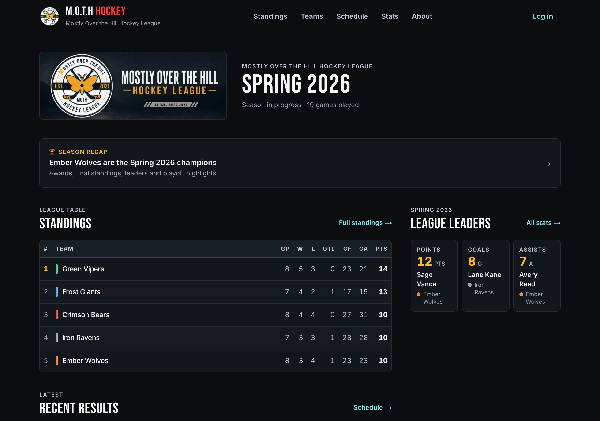
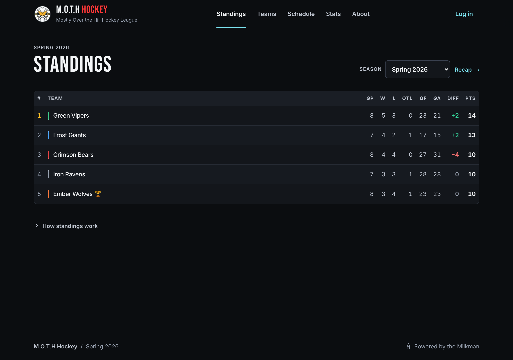
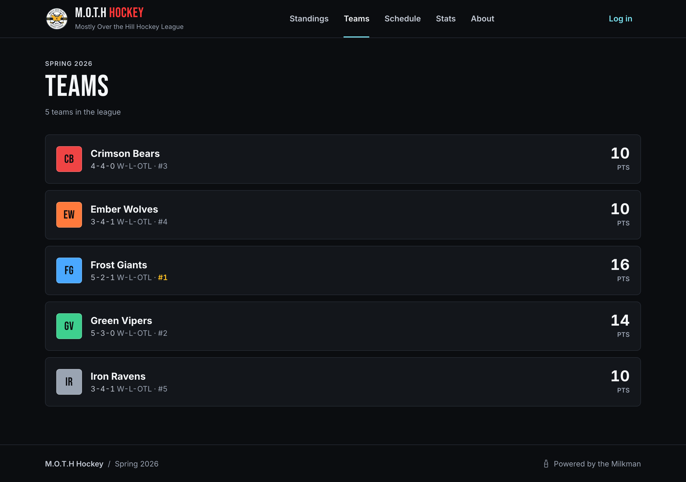
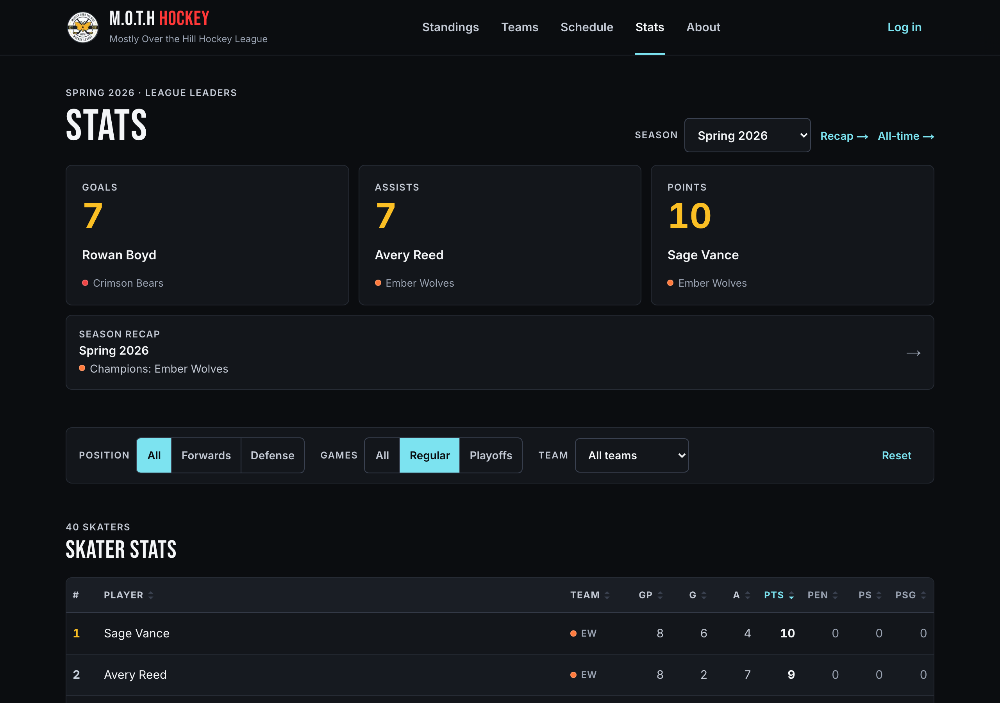
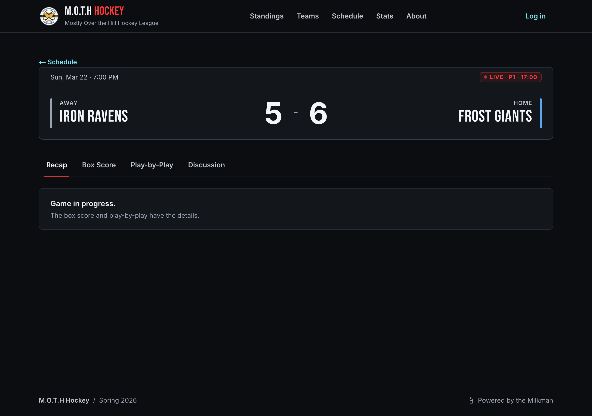
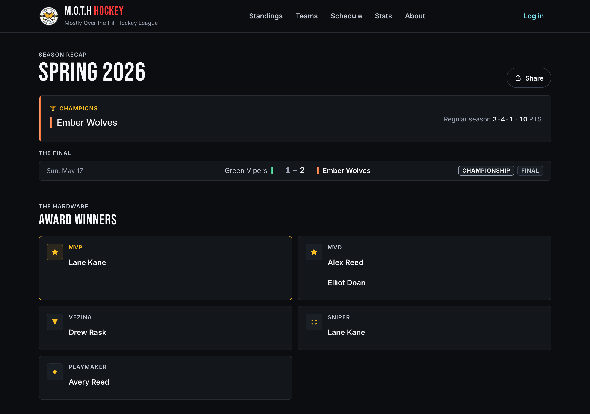
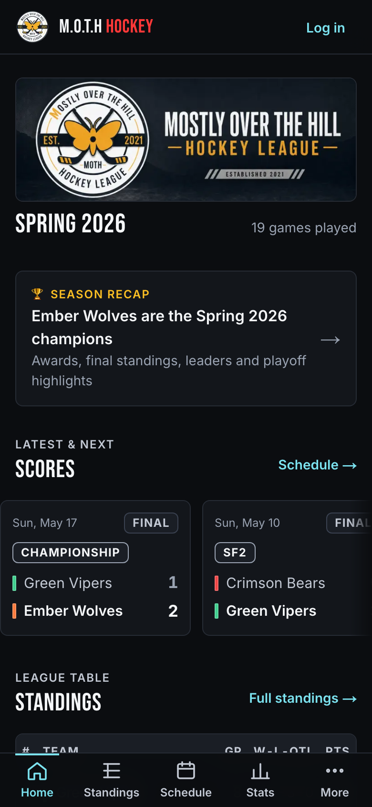
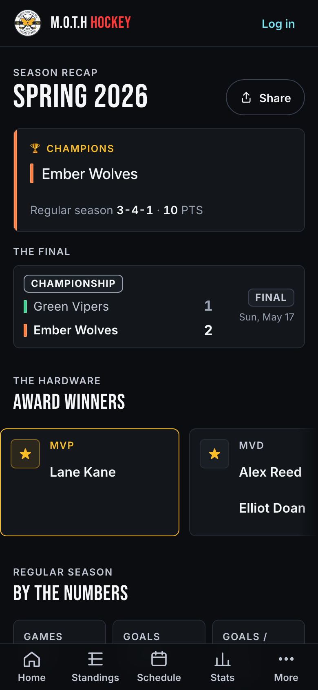
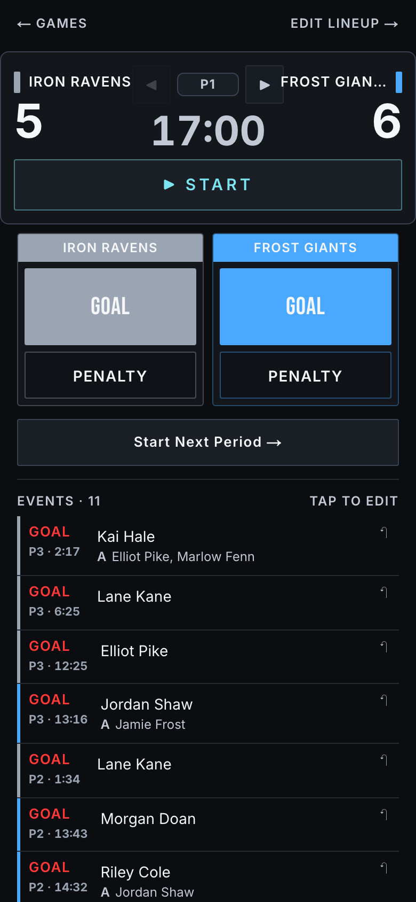

# M.O.T.H Hockey

## Overview

**M.O.T.H Hockey** ("Mostly Over The Hill") is a league-management web app. It gives everyone public scores, standings, and stats,
while the people who run the league get live scoring and admin tooling behind a login.

It is **mobile-first** by design — most users are on a phone at the rink, on the bench, or between
shifts — with a flat dark theme, per-team accent colors, and a bottom tab bar on phones. Pages are server-rendered from
Supabase, and player/goalie stats are derived at query time from the game event log rather than
stored as aggregates.

🏒 **Live:** [moth-hockey.vercel.app](https://moth-hockey.vercel.app/)



## Environments

| Environment | URL |
| ----------- | --- |
| Production | [https://moth-hockey.vercel.app](https://moth-hockey.vercel.app) |
| Staging | [https://moth-hockey-git-staging-doug-morands-projects.vercel.app](https://moth-hockey-git-staging-doug-morands-projects.vercel.app) |

## Features

### Public (no login)

| Feature             | What it does                                                                                     |
| ------------------- | ------------------------------------------------------------------------------------------------ |
| **Home**            | Standings, league leaders, recent results, upcoming games, and the Locker Room board. |
| **Season picker**   | A season dropdown in the site header switches Home, Teams, Standings, Schedule and Stats to a past season. The choice lasts for the browser session; a `?season=<id>` link overrides it. |
| **Standings**       | Per-season point system (3-2-1 or 2-1-0) with full tiebreakers (pts → fewest PIM → fewest goals against → most goals for, then team name). |
| **Teams & rosters** | Per-team roster grouped by forwards / defense / goalies with each player's season stats, plus team record, schedule, and a captain badge. Past-season teams open via `?season=<id>`. |
| **Schedule**        | Full season schedule with a shareable team filter (`/schedule?team=<slug>`), and playoff round chips. |
| **Game pages**      | Box score with goal and penalty-shot log (OT and shootout), a projected line and AI-written preview before the game, and an AI recap after it. |
| **Player profiles** | Career stats per season plus all-time totals, interactive award badges, and captain history.     |
| **Stats**           | Season leaders (points, goals, assists, penalties, goalies; subs don't count toward leaders) and paginated all-time stats. |
| **Season recap**    | `/seasons/<slug>/recap` (and `/recap` for the latest): champion and a lead photo, an AI-written season report, awards, final standings, leaders, highlights, a separate playoffs section, and a photo/video gallery with a full-screen viewer (swipe, pinch/double-tap zoom). Jump links at the top; shareable, with a link-preview image. |
| **Locker Room**     | Season message board on the home page, plus per-game threads.                                    |
| **Content pages**   | Markdown-powered rules, FAQ, and league info, editable by admins.                                |

### Players (signed in)

| Feature             | What it does                                                                                     |
| ------------------- | ------------------------------------------------------------------------------------------------ |
| **Check-in**        | Mark yourself in or out for the next game from your account or the game page.                    |
| **Locker Room posts** | Post and reply on the season board and game threads (account must be linked to a player).      |

### Scorekeeper

| Feature             | What it does                                                                                     |
| ------------------- | ------------------------------------------------------------------------------------------------ |
| **Roster check-in** | Pre-game check-in of who's playing, including adding subs.                                        |
| **Home-screen app** | Installable as a PWA so the scoring view opens full-screen from the phone's home screen.          |
| **Live scoring**    | Mobile-first scoring UI with a sticky running clock and GOAL / PENALTY-SHOT flows, each with UNDO. |
| **OT & shootout**   | Sudden-death overtime and shootout sub-flows.                                                    |
| **Finalize**        | Lock a game once it's complete. Finalized games can no longer be edited by scorekeepers.          |

### Captain

| Feature               | What it does                                                                  |
| --------------------- | ----------------------------------------------------------------------------- |
| **Contact directory** | Email and phone for every rostered player, grouped by team.                   |
| **Availability & subs** | Manage who's in or out for a game and line up subs ahead of time.          |

### Admin

| Feature                | What it does                                                                  |
| ---------------------- | ----------------------------------------------------------------------------- |
| **League data CRUD**   | Create and edit teams, players, rosters, and the schedule.                    |
| **Export players**     | Download the filtered players list as a CSV (`moth-players-YYYY-MM-DD.csv`). Pick columns first; names only unless others are selected. |
| **Season management**  | Round-robin generation, season activation, and playoff seeding.               |
| **Finalize a season**  | Lock in season totals and awards once the playoffs end; the season recap links from here. |
| **Content & awards**   | Edit the markdown content pages and assign per-season player awards.          |
| **AI write-ups**       | Edit or hide the AI-written game previews and recaps.                         |
| **Season recap**       | Generate, edit and publish the AI season report; upload, caption, reorder and delete gallery photos, videos and PDFs (stored in Vercel Blob). The first photo leads the recap. |
| **Users & roles**      | Link signups to players and assign roles (scorekeeper, admin, etc.).          |
| **Edit finalized games** | Correct events on games scorekeepers have already locked.                    |

## Roles

Auth is passwordless **magic-link** only — players sign in once or twice a season.

| Role           | How it's assigned                       | Can do                                                                          |
| -------------- | --------------------------------------- | ------------------------------------------------------------------------------- |
| `player`       | Default for every signup                | Browse public pages; edit own profile; check in for games; post in the Locker Room.                                          |
| `team_captain` | Derived from the `team_captains` table  | All player abilities + the contact directory and game availability / subs.     |
| `scorekeeper`  | Assigned by an admin                    | All player abilities + live scoring (`/score`). Cannot edit finalized games.    |
| `admin`        | First one promoted by hand; rest via UI | Everything — full CRUD, season management, awards, and role assignment.          |

Contact info (email/phone) is never exposed on public pages; RLS limits reads to self, admins, and captains.

## Tech stack

- **Next.js 16.2.6** (App Router) + **React 19.2.4** — server-first React Server Components.
- **TypeScript** — path alias `@/*` → repo root.
- **Tailwind v4** — configured in `app/globals.css`, not `tailwind.config.*`.
- **Supabase** — Postgres + Auth.
- **OpenRouter** — LLM calls for the AI game previews, recaps and season reports.
- **Vercel Blob** — season recap photos, videos and PDFs (direct browser uploads).
- **bun** — package manager and runtime.
- Deployed on **Vercel + Supabase cloud** (free tiers, ~$0/month).

> Next.js 16 and React 19 have breaking changes vs. older versions. See [`CLAUDE.md`](CLAUDE.md) and [`docs/ARCHITECTURE.md`](docs/ARCHITECTURE.md) before writing code.

## Getting started

Requires [bun](https://bun.sh) and the [Supabase CLI](https://supabase.com/docs/guides/cli) (run via `bunx`).

```bash
bun install
bunx supabase start      # local Postgres + Auth + Mailpit
bunx supabase db reset   # apply migrations + reseed the test users
bun dev                  # http://127.0.0.1:3001
```

Sign in with a magic link: open [`/login`](http://127.0.0.1:3001/login), enter one of the seeded
emails below, then open Mailpit at [http://localhost:54324](http://localhost:54324) and click the link.
`supabase db reset` recreates these accounts every time.

| Email                   | Role          |
| ----------------------- | ------------- |
| `admin@moth.test`       | `admin`       |
| `scorekeeper@moth.test` | `scorekeeper` |
| `player@moth.test`      | `player`      |

See [`docs/LOCAL-TESTING.md`](docs/LOCAL-TESTING.md) for full local dev and testing details.

## Commands

- `bun dev` — start the dev server on port 3001
- `bun run dev:lan` — dev server reachable from a phone on the same Wi-Fi
- `bun run build` — production build
- `bun start` — run the production build
- `bun run lint` — ESLint
- `bun run test` — unit tests (`bun test` over the pure modules in `lib/`)

## Git workflow

`main` is the production line; `staging` is the pre-production line that the staging
deployment tracks. **All work flows through `staging` first, then gets promoted to
`main`** — never merge a feature branch straight into `main`, or the two branches
drift apart.

1. **Branch off `staging`:** `git checkout staging && git pull && git checkout -b fix/my-change`
2. **Open a PR into `staging`.** Review, then merge.
3. **Promote:** open a PR from `staging` → `main`. Merging it ships to production.
4. **Re-sync:** after the promotion merges, update `staging` so it isn't left behind:
   `git checkout staging && git merge origin/main`

This keeps `main` and `staging` from diverging — every change lands on `staging`
before `main`, and `staging` is brought back level right after each promotion.
See [`docs/RELEASING.md`](docs/RELEASING.md) for tagging releases.

## Screenshots

|                    Standings                    |                  Teams                  |
| :---------------------------------------------: | :-------------------------------------: |
|    |     |
|                   **Stats**                     |               **Box score**             |
|           |  |
|                **Season recap**                 |                                         |
|           |                                         |

**On a phone** — home, season recap, and the scorekeeper's live scoring view (running clock, per-team GOAL / PENALTY controls, and a tap-to-edit event log).

<p align="center">
  
  
  
</p>

## Status & roadmap

The MVP is live in production. Releases are tagged on GitHub; the original build plan is in
[`docs/initial-build/PLAN.md`](docs/initial-build/PLAN.md).

**Shipped:** public site, magic-link signup + roles, admin CRUD, full scorekeeper scoring, derived
stats/standings, game previews with projected lines, AI game write-ups, availability and subs,
the Locker Room board, season finalization with all-time stats, the season recap page with an
AI season report and a photo/video gallery, and the mobile-first layout with a bottom tab bar.

**Next:**

- Realtime box score — `/games/[id]` updating live from scorekeeper input.

## Documentation

Project docs live in [`docs/`](docs/README.md):

- [ARCHITECTURE.md](docs/ARCHITECTURE.md) — stack, directory layout, data flow, Supabase client split, auth & roles.
- [DATABASE.md](docs/DATABASE.md) — schema, enums, RLS, helper functions, and triggers.
- [DEVELOPMENT.md](docs/DEVELOPMENT.md) — dev workflow, the Supabase migrations loop, and conventions.
- [LOCAL-TESTING.md](docs/LOCAL-TESTING.md) — run locally, sign in as the seeded test users, and preview the mobile layout.
- [SUPABASE.md](docs/SUPABASE.md) — Supabase CLI reference: local stack, migrations, pushing to cloud.
- [RELEASING.md](docs/RELEASING.md) — branch model, migration pushes, and release tagging.
- [OPERATIONS.md](docs/OPERATIONS.md) — ops runbook: refresh staging seed data, load a season.
- [EMAIL.md](docs/EMAIL.md) — auth email / custom SMTP setup.
- [initial-build/PLAN.md](docs/initial-build/PLAN.md) — the master build plan and living source of truth.
- [adr/](docs/adr/README.md) — Architecture Decision Records.
